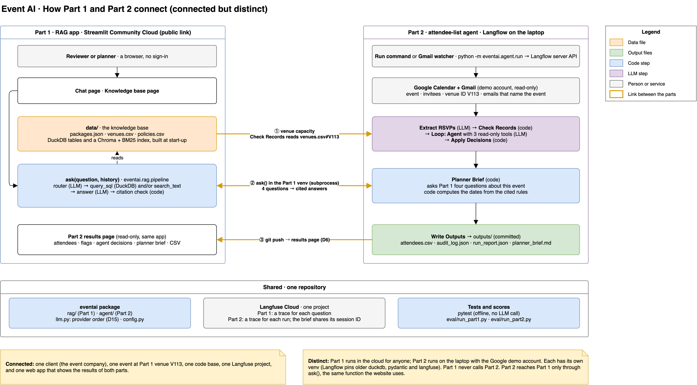
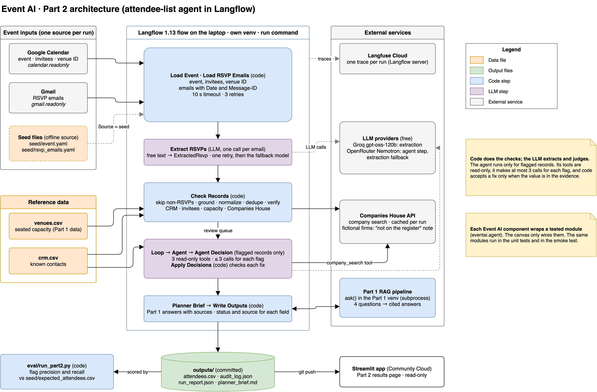

# Event AI: technical summary

Event AI is a demo in two parts for a fictional UK event company, built for the Inference Group AI Agent Technical Challenge. All names, firms, emails and phone numbers are synthetic.

- **Part 1, ask the knowledge base:** [event-ai-xyp3apsfydznwqktuhvxhu.streamlit.app](https://event-ai-xyp3apsfydznwqktuhvxhu.streamlit.app/)
- **Part 2, the last agent run (read-only):** [the same app, page "Part 2 results"](https://event-ai-xyp3apsfydznwqktuhvxhu.streamlit.app/part2-results)
- **Code, tests and the Langflow flow:** [github.com/jaco-verryne/event-ai](https://github.com/jaco-verryne/event-ai)

The free host puts the app to sleep when nobody uses it. If the page shows a wake-up button, click it and wait about one minute.

## The problem

The sales planners answer client questions every day: which Leeds venue seats 150, what a package includes, when the final guest numbers are due. The answers are in three files. A search by hand is slow, and a wrong answer costs money.

Before each event, a planner also makes the attendee list by hand from the calendar invitation and the RSVP emails. The replies are untidy: typos, the same person twice, a nickname, a substitute, an invalid phone number, and other mail in the same inbox.

## What the system does

**Part 1: a question-answering app (RAG) on the web.**

- A planner asks a question in plain English, and a follow-up question keeps the context. The app finds the records (SQL for numbers and categories, a meaning search for descriptions and rules), then writes the answer from those records only.
- Each fact shows its source record, for example `venues.csv#V012`. A Debug panel shows the plan, the SQL and the search scores.

**Part 2: an agent that makes a verified attendee list.**

- One command, or a Gmail watcher, finds the event in Google Calendar and reads the emails about it in Gmail, with read-only access.
- An LLM extracts the fields from each email. Code checks each value against its email, cleans it, merges duplicates, and verifies it against a CRM export, the invitee list, the UK Companies House register and the venue capacity.
- An LLM agent examines each flagged record with read-only lookups and proposes a fix. Code accepts a fix only when the value is in the evidence. Each other flag goes to a person.
- The output is an attendee list with a status and a source for each value, an audit log, a run report, and a planner brief with the dates that the booking rules set.

**How the parts connect:** Part 2 reads the venue capacity from the Part 1 data, asks Part 1 the planner-brief questions, and shows its results on a page of the Part 1 app.

## Results

| Part 1: 12 test questions (26 Oct) | Score | Part 2: the seed inbox (29 Oct) | Score |
| --- | --- | --- | --- |
| Expected facts in the answer | 97% | Data problems flagged | 6 of 6, no false flag |
| SQL result rows correct | 11 of 11 | Field values correct | 77 of 77 |
| Search hit in the top 5 | 5 of 5 | Duplicates merged (13 RSVPs, 11 people) | 11 of 11 |
| Answer cites an expected record | 10 of 10 | Agent decisions correct | 5 of 5 |
| Cited facts removed by the code check | 0 of 28 | Planner-brief answers with a source | 4 of 4 |
| Router tool choice as expected | 10 of 12 | Other mail kept off the list | 4 of 4, no RSVP lost |

Part 1 is scored against 12 questions with the expected tools, rows and facts (the two router misses gave correct data). Part 2 is scored against an answer key, written by hand, for a seed inbox with known defects and other mail.

**Why you can trust the output:** each fact and each value has a source (a record ID, an email or a CRM row). The LLM reads and proposes; code checks, decides and records. Nothing is invented: an absent value stays empty, and a doubt goes to human review, with a reason. Each question and each run has a Langfuse trace.



## How it works (for technical readers)

### Approach and architecture

- **Part 1 is a workflow, not an agent:** a router call, the tools in code, then an answer call. This gives a fixed cost of 2 LLM calls, repeatable runs, and one place for the guardrails.
- **Part 2 is a Langflow 1.13 flow.** Custom components wrap tested Python modules (`eventai/agent`). The LLM works in two steps only: extraction and the agent. The agent works in a bounded loop: flagged records only, at most 3 lookups for each flag, then one decision.



### Key reasoning steps

| | Part 1: each question | Part 2: each run |
| --- | --- | --- |
| 1 | **Router (LLM):** intent, tools, SQL, search words, standalone question | **Search (code):** Gmail finds the emails that name the event |
| 2 | **`query_sql`:** one read-only SELECT, known tables, 200 rows, 5 s | **Extract (LLM):** the fields and `is_rsvp`, one call for each email |
| 3 | **`search_text`:** Chroma + BM25 (RRF) on the SQL rows, a minimum score | **Check (code):** skip non-RSVPs, ground, normalize, dedupe |
| 4 | **Answer (LLM):** JSON from the tool results only, a source ID for each fact | **Verify (code):** CRM, invitees, Companies House, venue capacity |
| 5 | **Citation check (code):** remove a fact with an unknown source | **Resolve (agent):** one decision per flag; code accepts only evidence |
| 6 | | **Output (code):** the brief from Part 1, the dates, the files |

### Tools

| Tool | Use | Safety |
| --- | --- | --- |
| Google Calendar and Gmail APIs | The event, the invitees and the RSVP emails | Read-only scopes; 10 s timeout, 3 tries |
| Companies House API | The company name and status | A cache; a failed call adds a flag, the run goes on |
| CRM, invitee and company lookups | The agent's evidence for one flag | Read-only; at most 3 calls for each flag |
| `query_sql`, `search_text` | Part 1: SQL; meaning and keyword search | Six SQL guardrails; a minimum score |
| `ask()` | The Part 1 pipeline | The website and the Part 2 brief share it |

**Models (free):** Groq `openai/gpt-oss-120b` (Part 1, extraction) and OpenRouter `nvidia/nemotron-3.5-super-vl:free` (agent), each the fallback of the other. **Stack:** Python 3.12, Pydantic, DuckDB, sqlglot, Chroma, rank-bm25, fastembed, rapidfuzz, phonenumbers, Langflow, Streamlit, Langfuse, pytest.

### Data sources

| Source | Size | Use |
| --- | --- | --- |
| `data/`: packages, venues, policies | 8, 120 and 26 records | Part 1: specifications, a dataset, a policy table |
| Google Calendar and Gmail (demo account) | 1 event, 12 invitees, 17 emails | Part 2 input, with known defects and noise |
| `seed/crm.csv`, Companies House | 12 contacts; the live register | Part 2 reference data |
| `seed/expected_attendees.csv` | 11 attendees | The answer key for the Part 2 score |

All data is synthetic, because free providers can log prompts (POPIA, UK GDPR).

### Limits and next steps

| Limits | Next steps (production on Azure) |
| --- | --- |
| Free models have daily limits (a flag then goes to review) | Azure OpenAI, and Azure AI Search for the hybrid search |
| The data and the test sets are small and synthetic | Azure Container Apps; a Functions timer or Gmail push |
| The guardrails stop unsafe SQL, not every wrong query | Azure Key Vault; a self-hosted Langfuse in the client's region |
| Part 2 runs on a laptop, one event at a time | A screen for the review queue; a larger test set in CI |

<!-- end of summary -->

---

## Run it yourself

The two parts use separate virtual environments, because Langflow pins older versions of duckdb, pydantic and langfuse.

```bash
python3.12 -m venv .venv && source .venv/bin/activate
pip install -r requirements.txt                 # Part 1, the tests and the scorers
cp .env.example .env                            # then add your API keys
pytest                                          # offline, no LLM call
streamlit run streamlit_app.py                  # Part 1 on http://localhost:8501
```

Part 2 also needs a Google demo account (`seed/GOOGLE_SETUP.md`) and the Langflow venv:

```bash
python3.12 -m venv .venv-langflow
.venv-langflow/bin/pip install -r langflow_part2/requirements.txt
python seed/seed_google.py                      # one time: the event and the RSVP emails
python seed/seed_google.py --noise              # one time: the other emails
langflow_part2/serve.sh                         # Langflow on http://localhost:7860
```

In Langflow, import `langflow_part2/flows/part2.json`, or wire the flow by hand with `langflow_part2/WIRING.md`. Then:

```bash
langflow_part2/smoke.sh                         # the components, no LLM call
python -m eventai.agent.run                     # find the events in Calendar and run the flow
python -m eventai.agent.run --watch --every 60  # run again when the RSVP emails change
python eval/run_part1.py                        # Part 1 scores
python eval/run_part2.py                        # Part 2 scores
python docs/build_summary_pdf.py                # this summary as a PDF
```

## Evaluation in detail

### Part 1

The last full run was on 26 Oct 2026, with Groq `openai/gpt-oss-120b`, on the 12 questions in `eval/part1_questions.yaml`. The results are in `eval/results/2026-10-26_part1.json`.

| Metric | Score |
| --- | --- |
| Retrieval hit@5 (no LLM call) | 100% (mean recall@5: 80%) |
| Router tool choice | 83% (10 of 12) |
| SQL result check (result rows, not SQL text) | 100% (11 of 11) |
| Citation check: facts removed | 0 of 28 |
| Answer cites an expected record | 100% |
| Answer accuracy (expected facts in the answer) | 97% (11 of 12 fully correct) |

Known misses:

- Q9 and Q11 use other tools than the evaluation set expects, but give the correct data.
- Q10 (a follow-up question) gives the correct venues and parking values. It writes "does not have parking data recorded" instead of the agreed words "The data does not give".

The first full run on the same day gave 85% answer accuracy. Two changes followed. First, a follow-up question now sends the earlier SQL to the router, which fixed Q10. Second, Q3 and Q6 now accept each correct answer, not one fixed wording or one venue. The SQL score compares the same kind of ID as the reference query, so an extra ID column from a join does not count as an error.

### Part 2

The last scored run was on 29 Oct 2026 at 06:48, started with the run command on the Google demo account (3 min 29 s). The results are in `eval/results/2026-10-29_part2.json` and `outputs/`.

- Flags: precision 100% and recall 100% (6 of 6). Field values: 77 of 77. Merges: 11 of 11. Agent decisions: 5 of 5, with no agent answer rejected. Planner brief: 4 of 4 answers with sources, and the three dates (12 Nov, 12 Nov, 26 Dec).
- Other mail (D19): the inbox has 17 emails. The Gmail search found 15 and left out the newsletter and the advert. The extraction marked the out-of-office reply and the supplier quote as not RSVPs, and code kept them off the list. No RSVP was skipped.
- One miss that the score does not count: in the planner brief, the venue-and-access answer cited only the venue record. It said that the data does not give the access arrangements, but policy POL-ACC-02 gives them. The run of 28 Oct cited that policy. The answer invented nothing.
- The run of 28 Oct, before the other mail was in the inbox, gave the same scores. In that run the OpenRouter daily limit ran out before the last flag, and code sent that flag to human review.
- Three earlier runs on 28 Oct found three faults: the agent answer parser, one extraction rule and one planner-brief question. Each fault has a fix.

## Repository map

```
streamlit_app.py, pages/   the web app: Chat, Knowledge base, Part 2 results
eventai/rag/               Part 1: loaders, chunks, search_text, query_sql, router, answer, pipeline
eventai/agent/             Part 2: tools, extraction, checks, review, brief, outputs, the run command
langflow_part2/            the Langflow components, the saved flow, the wiring guide and the smoke test
data/                      the knowledge base: packages.json, venues.csv, policies.csv
seed/                      the Part 2 seed data, the answer key and the Google seed script
eval/                      the test questions, the scorers and the results
outputs/                   the last Part 2 run
docs/diagrams/             the diagrams (.drawio sources and PNG files)
tests/                     the unit tests
```

## Diagrams

Each `.drawio` file opens in [diagrams.net](https://app.diagrams.net). A Python script in `docs/diagrams/` builds each file.

- `event-ai-overview.drawio`: how Part 1 and Part 2 connect (`part1-part2-overview.png`).
- `event-ai-part1.drawio`: the Part 1 architecture, one record as a chunk, one question, and who calls the LLM (`part1-*.png`).
- `event-ai-part2.drawio`: the Part 2 architecture, the Langflow flow, the agent loop for one flag, and one attendee from email to output (`part2-architecture.png`, `part2-flow.png`, `part2-agent-loop.png`, `part2-record-flow.png`).
- `part2-walkthrough.drawio`: one email step by step, the four paths of an email, and where Part 1 works in Part 2 (`part2-step-by-step.png`, `part2-four-paths.png`, `part2-part1-role.png`).
